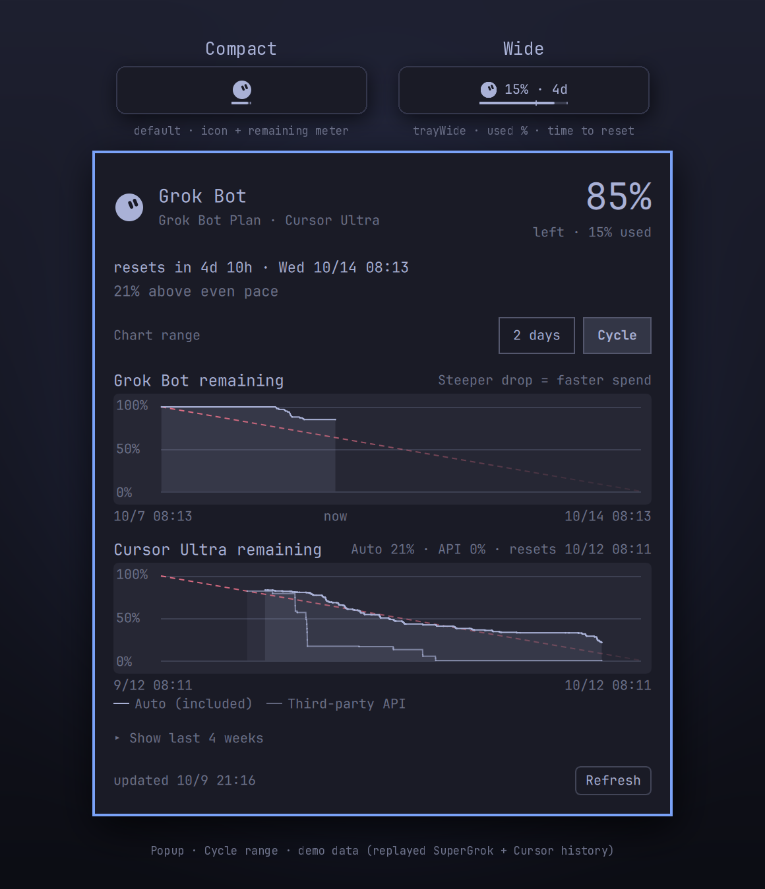

# Grok Bot Usage — Omarchy bar widget

Grok Bot's weekly usage on the Omarchy (Quickshell) bar.



*Demo data.* The Grok Bot chart replays real SuperGrok weekly history shifted
onto the Grok Bot week; the Cursor chart replays real Cursor Auto / other-model
history.

- **Bar**: the Grok Bot face (white round face, two slanted eyes, drawn as a
  one-colour symbolic SVG) with a remaining meter under it. Slot width
  (`Style.bar.iconSlot`), icon size (`Style.bar.iconCanvas`) and meter box
  (55% of the slot, 2px thick, 2px from the edge, hidden while the popup is
  open) are the same as omarchy-grok-cursor-usage's widget. The meter fill
  follows pace: normal at or under an even burn, amber slightly ahead, red well
  ahead or at ≤10% left. Used % and time to reset are in the tooltip. If a
  refresh fails, the last good reading stays, dimmed.
  `trayWide: "On"` switches to the wide layout instead: face + `24% · 4d`
  (used % and time to reset, `barLabel`), meter as wide as the content, plus
  an even-pace tick. Default is compact.
- **Popup** (charts, no progress bars). Chart range switch *2 days / Cycle*
  (setting `remainingAxis`); x-axis bounds, ticks (`M/D HH:MM` · now · reset ·
  `M/D HH:MM`) and the 0–100% y-axis use the same code as
  omarchy-grok-cursor-usage:
  - *Grok Bot remaining*: remaining quota falling from 100% to 0%, a 1px line
    with a flat fill, and one red dashed even-pace line across the whole
    period (100% at start → 0% at reset). No projection ray, no now/reset
    marker lines. Hover shows the value.
  - *Cursor remaining*: the Cursor plan's included pool from
    `GetCurrentPeriodUsage` — Auto (included models, solid) and third-party
    API (dimmer) — same style, one pace line.
  - *Last N weeks* (hidden by default; `h` or the "Show last N weeks" link
    toggles it, `showHistory: "On"` makes it default): every stored week's
    remaining curve overlaid by time into the week, older weeks fading out.
  - *Usage rows*: shown only when Cursor's usage events return `grok-bot-*`
    rows (`grok-bot-default`, `grok-bot-automation`, `grok-bot-cua`).

The popup footer shows the last update time and a Refresh button; the
background refresh (`refreshIntervalSec`) keeps running as a fallback.
Middle-click the bar to refresh. Right-click opens a small menu: *Open Cursor
spending page*, *Refresh*, and *Wide tray* On/Off (saved to the `trayWide`
setting).

## Data source

Grok Bot meters usage through Cursor. The collector reads the Cursor desktop
sign-in (`cursorAuth/accessToken` in
`~/.config/Cursor/User/globalStorage/state.vscdb`, opened read-only) and calls:

| RPC (POST, `https://api2.cursor.sh/aiserver.v1.DashboardService/…`) | Used for |
|---|---|
| `GetSandUsageStatus` `{}` | `usagePercent` (0–100), `currentPeriodStart`, `nextResetTimestampUtc`, `grokPlanLabel`, `cursorPlanName`, `billingBrand`, `hasAvailableUsage`, `onDemandSettings.dashboardUrl` |
| `GetAggregatedUsageEvents` `{teamId:-1,startDate,endDate}` | optional `grok-bot-*` rows (`modelIntent`, tokens, `totalCents`) |

This is the same meter the Grok Bot desktop app shows. The token is never
written to disk or printed. Requires Cursor desktop signed in with the account
Grok Bot uses (`python3`, standard library only).

Files (in `$XDG_STATE_HOME/omarchy/grokbot-usage/`, mode 0600):

- `usage.json`: latest record. On failure, `ok: false` and `error` are set,
  and the previous `usage` is kept.
- `history.json`: plateau-merged samples `{t, until, used, periodStart, resetsAt}`,
  12 weeks max.

## Install

```bash
omarchy plugin add https://github.com/songlairui/omarchy-grokbot-usage.git --enable
```

Update: `omarchy plugin update songlairui.grokbot-usage`.

## Remove

```bash
omarchy plugin remove songlairui.grokbot-usage
# optional: delete the stored readings
rm -rf "${XDG_STATE_HOME:-$HOME/.local/state}/omarchy/grokbot-usage"
```

The plugin only writes to that state directory and to its own bar settings
entry; it never edits Cursor or Grok Bot files (the Cursor database is opened
read-only).

Settings (`omarchy bar set songlairui.grokbot-usage <key> <value> --json`):

| key | default | |
|---|---|---|
| `trayWide` | `Off` | `Off` = compact (reference width), `On` = wide with label |
| `barLabel` | `percent-reset` | wide tray only: `percent-reset`, `percent`, or `icon` |
| `remainingAxis` | `days` | `days` (2-day window, shared rule) or `cycle` (each chart spans its own period: Grok Bot week, Cursor billing month); also switchable in the popup |
| `refreshIntervalSec` | `300` | 60–3600 |
| `showHistory` | `Off` | `On` shows the multi-week overlay by default |
| `historyWeeks` | `6` | weeks in the comparison chart (2–12) |

IPC: `omarchy-shell songlairui.grokbot-usage refresh|toggle|open|close|toggleHistory`.

Collector by hand: `python3 collect.py --force --print`.

## Keeping the Grok Bot app in the background

Grok Bot work runs on its cloud computer, so closing the app does not stop
Bots. The desktop app only needs to stay open for local-computer access,
notifications, and quick access. On Linux it has no tray icon and quits when
its last window closes. Two optional recipes live in `extras/` (neither is
installed or enabled by this plugin):

- `extras/hypr/grok-bot.lua` (recommended): start at login with
  `o.launch_on_start("grok-bot")` and open it silently on Omarchy's
  scratchpad (`SUPER + S` toggles it). Hide it instead of closing it.
- `extras/systemd/grok-bot.service`: a user service with `Restart=on-failure`
  for crash recovery, bound to `graphical-session.target`.

## Development

```bash
python3 -m unittest discover -s tests
omarchy plugin validate .
```

The repository root is the plugin folder (as `omarchy plugin add` requires).
`extras/` and `tests/` are not loaded by the shell.
